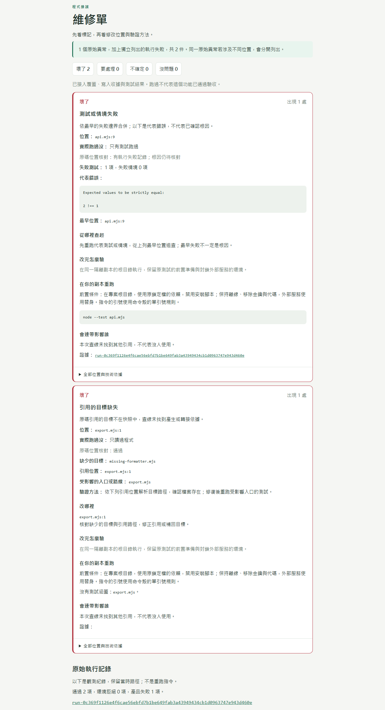
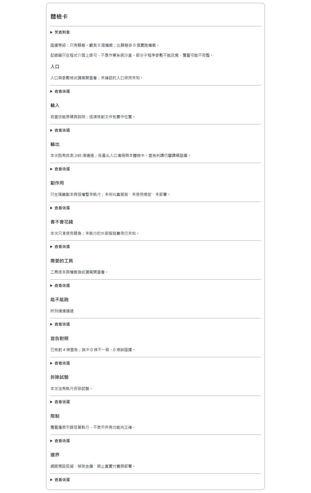
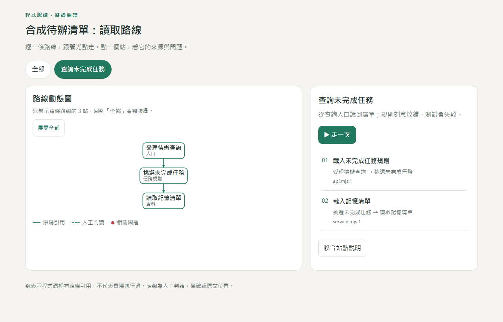

# Trace Code Lines 1.21.0

[English](#english) · [繁體中文](#traditional-chinese)

## English

Trace Code Lines never treats a description as proof of success. Its review workflow ties each conclusion to a code location or an actual execution record and labels its evidence level: **real use > scenarios with stand-ins > executed tests > static reading**. An agent's narrative is not evidence. Authorized runs take place in isolated copies, use stand-ins for paid services and models, remove credentials from the child environment, and block live paid, login and deployment actions. The result is a human-facing maintenance sheet: related observations are grouped, marked **broken / needs attention / fine / uncertain**, and accompanied by repair guidance and verification commands when the evidence supports them.

Stop-site comparison is available under declaration checks. Add `stopSites.policy` to the report configuration to compare JS/TS/Python termination and refusal candidates with an explicitly supplied hard-block policy. Results are baseline, needs attention or uncertain, with source/policy anchors, file-route reach and available verification commands. Private/type guards and mixed conditions remain uncertain; without a declaration, the tool lists candidates only. Reason/keyword mappings are optional, and results remain diagnostic suggestions for agent review. See [configuration and limitations](references/stop-sites.md).

Reverse a map with `node scripts/reach.mjs --map map.json --target src/helper.mjs` (repeat `--target`, or use `--targets-file`). It reports roots by population, direct importers, lexical uses with snippet hashes, and fallback guard hints. Hints support agent review and never authorize deletion; stale maps become UNKNOWN. `derive-map` and `reach` emit parseable JSON on stdout; `derive-map` progress goes to stderr. With `--out`, the full JSON goes to a new file and stdout contains a compact JSON receipt with absolute `outputs` paths. See [reach](references/reach.md) and [runner](references/runner.md).

Check dependency direction across repositories with `node scripts/boundary.mjs --config boundary.json [--out result.json]`. Configured zones and marker rules classify resolved static edges and lexical dynamic import/require/read/spawn paths as VIOLATION, DECLARED, ALLOWED or UNKNOWN. Every finding carries source anchors and hashes; unknown paths and skipped files remain visible. A declared marker is a routing signal, not proof of runtime safety. Findings support maintenance and check-card review at most as needs attention, without changing broken counts. See [boundary configuration and limits](references/boundary.md).

Reports group the same verdict, reason and file, showing at most 20 groups per category by default. Production-route groups come first, then occurrence count. Each group shows item/occurrence totals and up to three anchors. Uncertain groups name the missing caller contract, execution evidence, condition or declaration. Omitted groups are counted; complete lists remain in JSON and broken counters retain their original meaning.

All public CLIs support `--help` without a configuration. Report config accepts `unusedExclusions.conventionLoaded` globs, `staticDirectories` and `historyDirectories` as repo-relative directories. Matching unused candidates become declared exclusions with a separate count; declarations are not runtime evidence. Boundary follows one same-file named call level up to a unique caller argument or down to one top-level helper return. Multiple assignments, ambiguous callers and unsupported helpers retain UNKNOWN. `--out result.json` also writes a bounded `result.json.md`. See [report settings](references/maintenance.md) and [boundary](references/boundary.md).

### How it differs from maps and summaries

A dependency map shows where code points; a summary describes what it appears to do. This workflow also checks documented claims against implementation, separates observed failures from static candidates, and shows what was actually exercised. Missing evidence stays explicit. Grouped failures share an observed boundary; grouping does not prove a common root cause. The agent still reads source and supplies semantic judgments; this is not a fully automatic correctness checker.

### Install

Requires **Node.js 22 or newer**. Static mapping also requires Git. The complete self-check needs an existing Python 3 installation for Python coverage checks; set `TRACE_PYTHON` if needed. The tools use built-in Node modules and the Python standard library; no package installation is needed.

Extract the release ZIP and place the **entire** `trace-code-lines` directory in either location:

| Agent | Skill directory |
| --- | --- |
| Claude Code | `~/.claude/skills/trace-code-lines/` |
| Codex | `~/.codex/skills/trace-code-lines/` |

Start a new conversation in the project you want to inspect. Keep `SKILL.md`, `scripts/`, `references/` and `assets/` together.

### Use

Ask the agent:

> Inspect this repository with trace-code-lines. Compare its documentation with its implementation, and label the evidence behind each conclusion.
>
> Is this skill doing what it claims? Show source locations and any missing evidence.

The default review reads code without running the inspected project. To authorize execution, name an isolated copy and a temporary directory, then say:

> You may run tests and API scenarios in this copy. Use stand-ins for external services; no paid calls, real credentials or deployment.

For a quick inventory, run from the extracted skill directory:

~~~text
node scripts/inspect-repo.mjs --repo /path/to/repo-copy --out /path/to/report
~~~

Replace the placeholders with your own absolute paths. Keep the report directory outside the inspected copy. Open `health.html` in the report directory. **This command generates entry candidates and a check card only**; it does not run tests or build the full maintenance sheet. Ask the agent to read the source, complete parameters and outputs, compare declarations, then use the mapping and reporting workflow in `SKILL.md`.

To run the skill's own checks:

~~~text
node scripts/self-test.mjs
~~~

### Outputs and examples

- **Maintenance sheet:** grouped findings with broken, needs attention, fine or uncertain labels; source anchors, evidence levels, repair guidance and available rerun commands. Missing fixes or test coverage remain explicit.
- **Check card:** entry points, inputs, outputs, processes, network and cost boundaries, required tools, runnability and declaration comparisons.
- **Offline HTML and JSON:** readable reports plus structured data. Authorized runs add scenario records, coverage, write receipts and stand-in records.
- **Optional route map:** source-checked references and reading guidance. Animated dots do not prove execution or call order.
- **Optional removal trials:** per-candidate results. A completed trial is not permission to delete code.

The screenshots below use only a small synthetic task-list demo and this skill's own self-check. The demo deliberately contains a failing test and a missing import. The demo project and raw run records are not included in the public ZIP; only the screenshots are included. Screenshot source HTML uses neutral paths for presentation; original local evidence remains separate.

**Synthetic demo: observed test failure and source-checked missing import.**

**Skill self-check: bounded results and explicit evidence limitations.**

**Synthetic demo route map: references, not a runtime trace.**

### Boundaries

The original repository stays read-only. Execution is limited to the copy and output locations you authorize. Dependencies follow the existing lockfile with installation scripts disabled; without a lockfile, the workflow records the limitation instead of inventing or updating dependencies.

Runs remove credentials and tokens from the child environment and deny undeclared network requests. Paid models, cloud services and other paid operations use stand-ins, fixtures or existing recordings. Real account login, paid calls, deployment, email, push and production writes are hard stops. Each experiment uses its own temporary directory and checks process and listening-port cleanup.

The recorder uses **API hooks, not an operating-system sandbox**. Native programs and unhooked execution paths can escape observation; use a container or virtual machine when stronger isolation is required. Python audit cannot rewrite child-process arguments, so child coverage may be incomplete. Coverage is not business acceptance, exit zero is not an overall success verdict, and an unobserved file is not necessarily unused or safe to remove.

Static parsing is bounded. Computed imports, build configuration, complete syntax trees and cross-file dataflow have limitations. Source anchors verify locations and text; they do not independently validate the agent's interpretation. Read technical details as needed: [observation sources and scenarios](references/water-sources.md), [check cards](references/check-card.md), [static mapping](references/runner.md), [maintenance rules](references/maintenance.md) and [route maps](references/route-map.md).

### Current language support

**The skill instructions and generated reports are currently in Traditional Chinese. There is no English report interface yet.** This English README explains installation, usage and boundaries; it does not translate the skill or its report UI. Technical identifiers and raw error messages retain their original language.

### License

[MIT License](LICENSE), Copyright (c) 2026 AWEI-73.

`scripts/self-test.mjs` retains MIT-licensed crewAI source excerpts solely as parser fixtures; they are not imported or executed. They cover subprocess calls in CLI/development tools and event, memory, storage and tool modules. Versions and source locations appear beside the fixtures. See the complete [third-party copyright and license notice](references/fixture-source-license.txt). Other source-inspired syntax cases have been rewritten as synthetic library-lending examples; see [fixture origins](references/g13-fixture-origins.json).

---

## 繁體中文

報告按「同判定、同原因、同檔案」合併，每類預設顯示 20 組，先列正式路線，再按件數排序。每組附件數、出現處數與前三個錨點；不確定按呼叫端合約、執行證據、觸發條件等缺口分小類。省略組數明列，完整清單只放 JSON，不改「壞了」計數與原判定。

所有 CLI 支援 `--help`。`unusedExclusions` 可宣告 `conventionLoaded` glob、`staticDirectories` 與 `historyDirectories` 目錄；符合的沒人用候選改標「依宣告排除」並另列數量。boundary 追同檔呼叫端參數或 helper 回傳一層；多次指派、多呼叫端與不支援的回傳式仍保留 UNKNOWN。`--out result.json` 另寫 `result.json.md` 分組摘要。詳見[設定](references/maintenance.md)與[邊界](references/boundary.md)。

Trace Code Lines **不把描述當成功**。查線流程要求每個結論對到程式位置或實際執行紀錄，並標明證據等級：**真實使用 ＞ 用替身的情境試跑 ＞ 測試跑過 ＞ 只讀程式**；agent 的敘述不算證據。獲授權的試跑只在隔離副本進行，付費服務與模型使用替身，子程序環境移除帳密，真實付費、登入與部署動作一律擋下。產出是給人看的維修單：合併相關觀測，標記為**壞了／要處理／沒問題／不確定**，並在證據足夠時附修法與驗證指令。

宣告對照新增阻擋點檢查：在報告設定提供 `stopSites.policy`，把 JS／TS／Python 終止與拒絕候選分成底線、要處理、不確定，附原碼／宣告錨點、檔案路線與可用驗證命令。內部防呆與混合條件保留不確定；沒宣告只能列清單，沒有 reason code 時準確度較低。結果交給 agent 判讀，不替人決定。設定與限制見[阻擋點對照](references/stop-sites.md)。
新增 `reach.mjs --map map.json --target src/helper.mjs`，可重複 `--target` 或用 `--targets-file`，反查入口分組、直接 importer、名稱使用行與片段 hash、回退條件。提示交給 agent 判讀，不授權刪除；地圖版本不同時降為 UNKNOWN。derive-map 與 reach 的 stdout 可直接解析 JSON，進度走 stderr；`--out` 寫入完整 JSON，stdout 僅留含絕對路徑 `outputs` 的精簡收據。詳見 [reach](references/reach.md) 與 [runner](references/runner.md)。

新增 `boundary.mjs --config boundary.json [--out result.json]`，以 zone 與 marker 規則檢查跨 repo 依賴方向。靜態邊與動態 import／require／read／spawn 路徑分為 VIOLATION、DECLARED、ALLOWED、UNKNOWN，附原碼錨點、hash、命中 marker 與缺口。負面觀察附檔數與略過原因；宣告命中不是執行安全證明。結果可附入維修單與體檢卡，最多標為要處理，不改壞了的計數。詳見 [boundary](references/boundary.md)。

### 跟地圖或摘要工具差在哪

依賴地圖顯示程式指向哪裡，摘要描述程式看起來做什麼。這個流程還會核對文件宣告與實作、區分已觀測故障和靜態候選，並說清楚哪些路徑真的跑過。缺證據就明寫。故障合併只表示觀測到相同邊界，不代表已證明共同根因。agent 仍須讀原碼並提出語義判讀；這不是全自動的正確性檢查器。

### 安裝

需要 **Node.js 22 或更新版本**。靜態地圖另需 Git。完整自測的 Python 覆蓋檢查需要既有 Python 3；必要時可設定 `TRACE_PYTHON`。工具只用 Node 內建模組與 Python 標準庫，不用先安裝套件。

解壓縮發行 ZIP，將**整個** `trace-code-lines` 資料夾放到其中一個位置：

| Agent | 技能資料夾 |
| --- | --- |
| Claude Code | `~/.claude/skills/trace-code-lines/` |
| Codex | `~/.codex/skills/trace-code-lines/` |

在要檢查的專案開啟新對話。請將 `SKILL.md`、`scripts/`、`references/` 與 `assets/` 保持在同一份技能目錄內。

### 使用方式

可以對 agent 說：

> 用 trace-code-lines 幫我查這個 repo，核對文件跟實作，並標明每個結論的證據等級。
>
> 這個 skill 有沒有做到它宣稱的事？請列原碼位置與缺少的證據。

預設只讀程式，不執行受查專案。若要授權試跑，先指定隔離副本與暫存目錄，再說：

> 可以在這份副本跑測試與 API 情境，外部服務用替身；不准付費、使用真帳密或部署。

想先取得基本清冊，可在解壓後的技能資料夾執行：

~~~text
node scripts/inspect-repo.mjs --repo /path/to/repo-copy --out /path/to/report
~~~

將範例路徑換成自己的絕對路徑，報告放在受查副本外。開啟報告目錄的 `health.html`。**這個指令只產生入口候選與體檢卡**，不會跑測試，也不會建立完整維修單。接著請 agent 讀原碼、補齊參數與輸出、核對宣告，再依 `SKILL.md` 的查線與報告流程處理。

執行技能本身的自測：

~~~text
node scripts/self-test.mjs
~~~

### 會拿到什麼與範例

- **維修單：** 合併相關發現，標記壞了、要處理、沒問題或不確定；列來源錨點、證據等級、修法與可用的重跑指令。缺修法或測試覆蓋時照實說明。
- **體檢卡：** 入口、輸入、輸出、程序、網路與費用邊界、工具需求、能否執行及宣告對照。
- **離線 HTML 與 JSON：** 給人閱讀的報告與結構化資料。獲授權試跑時，加上情境紀錄、覆蓋、寫入收據與替身紀錄。
- **按需路線圖：** 核對過原碼的引用與閱讀導引。動畫光點不代表真的執行過，也不證明呼叫順序。
- **按需拆除試驗：** 逐候選列出結果；試驗完成不等於獲准刪除程式。

以下截圖只來自小型合成待辦清單範例與本技能自查。範例刻意放入一個失敗測試與一個缺檔 import。公開 ZIP 不含範例專案或原始試跑紀錄，只包含截圖。截圖用 HTML 以中性路徑呈現，原始本機證據另行保存。

**合成範例：實際觀測的測試失敗，以及核對原碼後確認的缺檔引用。**

**技能自查：限定範圍的結果與明列的證據限制。**

**合成範例路線圖：呈現引用，不是執行追蹤。**

### 邊界

原專案只讀。執行只限你授權的副本與輸出位置。依賴照既有鎖定檔安裝並關閉安裝腳本；缺鎖定檔時保留限制，不自行補造或更新依賴。

試跑移除子程序環境中的帳密與 token，拒絕未宣告的網路請求。付費模型、雲端服務與其他付費操作只用替身、假資料或既有錄音。登入真帳號、真實付費、部署、寄信、push 與正式資料寫入是硬停。每個實驗使用自己的暫存目錄，並核對程序與監聽埠清理。

記錄器是 **API 掛勾，不是作業系統沙盒**。原生程式與未掛勾的執行路徑可能漏記；需要更強隔離時應使用容器或虛擬機。Python audit 不能改寫子程序參數，子程序覆蓋可能不完整。覆蓋不等於業務驗收，exit 0 不等於整體成功；未觀測到的檔案也不一定沒人用或可以刪除。

靜態解析有範圍限制。計算式 import、打包設定、完整語法樹與跨檔資料流仍有限制。來源錨點核對位置與文字，不會獨立證明 agent 的語義判讀。需要時再讀技術細節：[水源與情境](references/water-sources.md)、[體檢卡](references/check-card.md)、[靜態查線](references/runner.md)、[維修單規則](references/maintenance.md)與[路線圖](references/route-map.md)。

### 目前的語言支援

**技能說明與產出的報告目前是繁體中文，尚無英文報告介面。** 這份英文 README 說明安裝、用法與邊界，不表示技能或報告介面已英文化。技術識別碼與原始錯誤訊息保留原語言。

### 授權

採用 [MIT 授權](LICENSE)，Copyright (c) 2026 AWEI-73。

`scripts/self-test.mjs` 保留 crewAI 的 MIT 原碼摘錄，僅供解析測試，不會匯入或執行。片段涵蓋命令列與開發工具的子程序呼叫，以及事件、記憶、儲存與工具模組；版本與來源位置標在測試旁。完整通知見[第三方著作權與授權](references/fixture-source-license.txt)。其他來源啟發的語法案例已改寫成合成圖書借閱範例，見[範例來源](references/g13-fixture-origins.json)。
